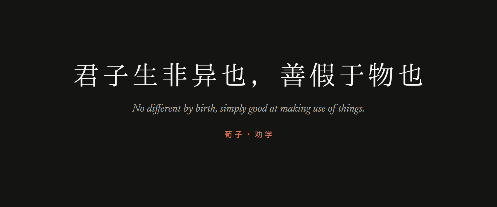
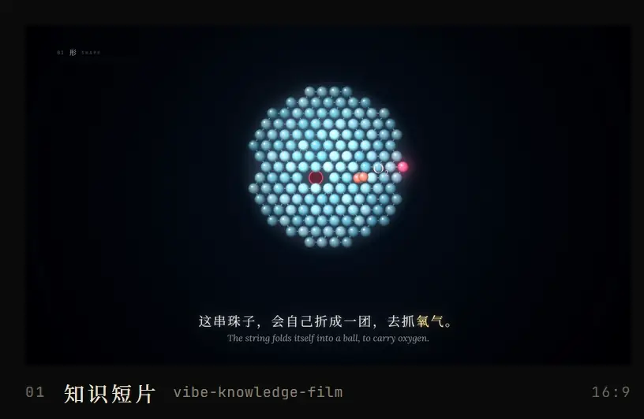
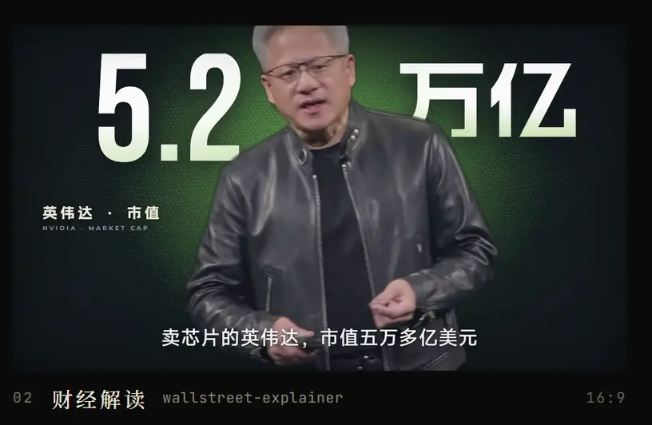
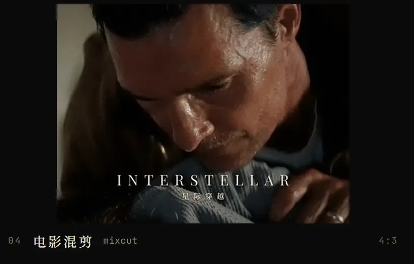

我用 AI 和代码做短视频。

看到爆火的视频，我会拆开看它为什么好看：画风、节奏、镜头、音效。总结成一套方法，再做成 skill。交给 Claude Code 或者 Codex，给它一个选题，就能出片。

画面都是用代码一帧一帧画出来的。

### 做视频的 skill

 

- **[vibe-knowledge-film](https://github.com/HeyChengC/vibe-knowledge-film)**　Vibe 知识大赏风格的短片。「夜曲」讲难懂的知识，「寓言」把心理和行为演出来。
- **[wallstreet-explainer](https://github.com/HeyChengC/wallstreet-explainer)**　华尔街式财经、科技解读短片。真实素材加数据可视化，克制，有质感。
- **[bighead-collage](https://github.com/HeyChengC/bighead-collage)**　大头拼贴人物短片。给选题和文案，出一条 9:16 竖屏人物故事。
- **[mixcut](https://github.com/HeyChengC/mixcut)**　电影混剪。给一个主题或片名，自己找片、下片、找配乐，先用一句原台词立住题，再让画面把它说完。

### 教程和工具

- **[vibe-editing-guide](https://github.com/HeyChengC/vibe-editing-guide)**　Vibe 剪辑入门。用一张嘴指挥 AI 剪片，指令可以直接复制。
- **[ai-cleaner](https://github.com/HeyChengC/ai-cleaner)**　AI清理工。把电脑整理成适合用 AI 写代码的样子，Windows 和 Mac 都能用。

### 怎么用

这些 skill 都能装进 Claude Code 或 Codex。每个仓库的 README 里有安装方法和样片。

### 联系

微信号 Yangdavee，备注来意。
